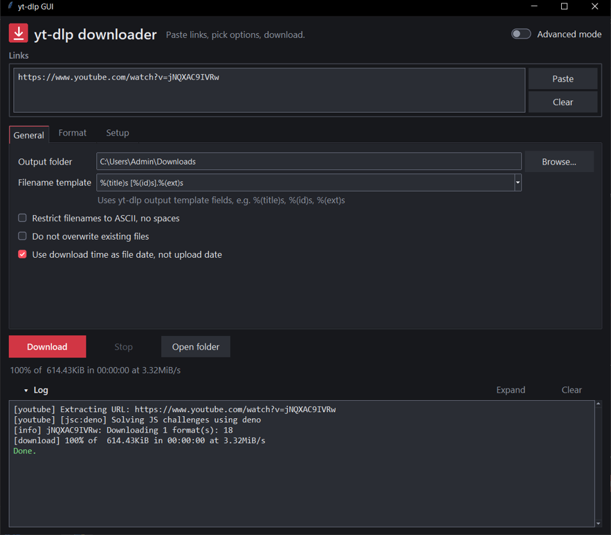
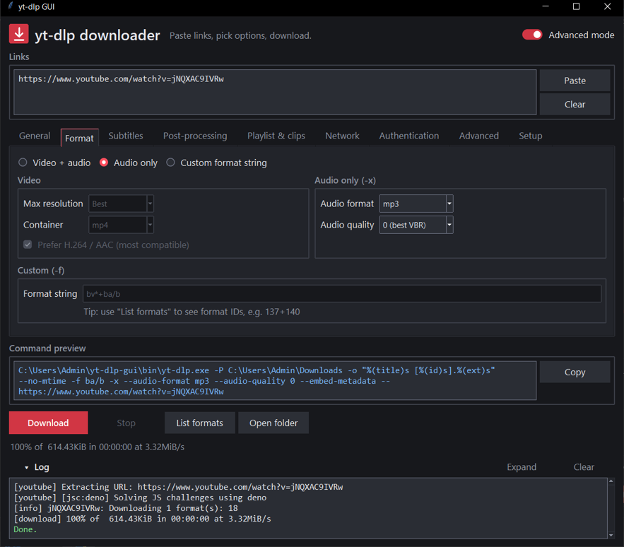
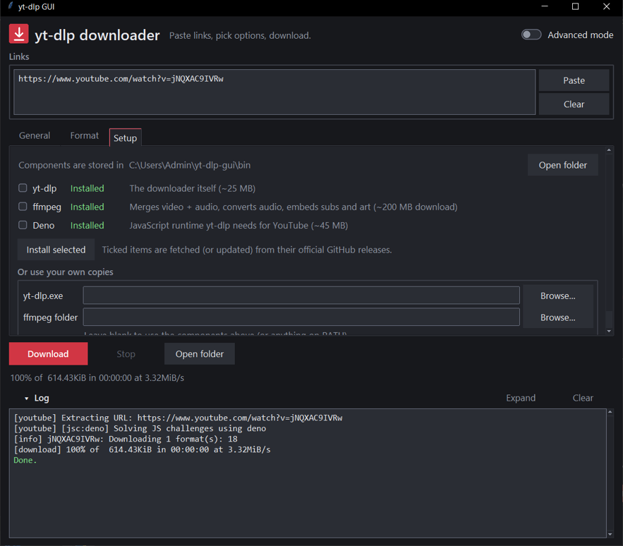

# yt-dlp GUI

A dark-themed Windows desktop app for [yt-dlp](https://github.com/yt-dlp/yt-dlp): paste links, pick options, and download, with no command line needed. It ships as a single standalone `.exe` with yt-dlp bundled inside.



## Features

- **Simple and advanced modes.** Simple mode shows only the essentials (General, Format, Setup). Switch on **Advanced mode** to show every option, a live command preview and **List formats**. If options you can't see are changed from their defaults, the header says so.
- **Format choice:** video + audio with a resolution cap and container, audio only (mp3, m4a, opus, flac, wav…), or your own `-f` format string.
- **Subtitles:** download, auto-generated, embed, convert to srt/vtt/ass/lrc.
- **Post-processing:** embed metadata, thumbnail and chapters; save the thumbnail, description or info JSON; SponsorBlock (mark or remove segments).
- **Playlists and clips:** single video or the whole playlist, item ranges, a download archive that skips videos you already have, time-range clips, split by chapter.
- **Network:** rate limit, retries, concurrent fragments, sleep, proxy.
- **Authentication:** cookies from your browser or a cookies file, username / password / 2FA, video passwords, `.netrc`. Passwords are never saved to disk and show as `********` in the preview and the log.
- **One-click setup:** the Setup tab finds yt-dlp, ffmpeg and Deno, and installs or updates any of them from their official GitHub releases. No admin rights or installers needed.
- **Live log** with colour-coded output and a single updating progress line. It can be expanded to fill the window.
- **Remembers your settings** between sessions (`%APPDATA%\yt-dlp-gui\settings.json`).

| Advanced mode | Setup tab |
|---|---|
|  |  |

## Requirements

- Windows 10 or 11 (64-bit).
- To run from source: Python 3.10+ with Tkinter (included in the python.org installer). The app uses only the standard library, so there's no `requirements.txt`. `requirements-build.txt` lists what's needed to build the exe.

## Getting started

### Option A: the prebuilt app

1. Build it (see below) or download `yt-dlp-GUI-win64.zip` from this repo's Releases.
2. Extract it somewhere you can write to, e.g. `C:\Tools\`, and run `yt-dlp-GUI\yt-dlp-GUI.exe`.
3. On first run, open the **Setup** tab and click **Install selected** to fetch ffmpeg and Deno (about 250 MB). yt-dlp is already included in `bin\`.

Windows SmartScreen may warn you because the exe is unsigned. Choose **More info → Run anyway**.

The app ships as a folder rather than a single exe on purpose. A single-file exe has to unpack about 2,000 files into `%TEMP%` every time it starts, which antivirus scanners and sandbox reports (e.g. VirusTotal) flag as "dropping files". The folder version starts faster and writes nothing at startup.

### Option B: run from source

```bat
git clone <this repo>
cd yt-dlp-gui
pythonw yt_dlp_gui.pyw
```

Double-clicking `yt_dlp_gui.pyw` also works. Use the **Setup** tab to install yt-dlp, ffmpeg and Deno.

## Building

Double-click **`build.bat`**, or run `build.bat /nopause` from a terminal. It will:

1. create an isolated build environment in `.build-venv\` and install the pinned PyInstaller from `requirements-build.txt`;
2. download `bin\yt-dlp.exe` if it isn't already there;
3. build the app folder `dist\yt-dlp-GUI\` (`yt-dlp-GUI.exe`, its `_internal\` files, and yt-dlp in `bin\`);
4. zip it as `dist\yt-dlp-GUI-win64.zip` (about 33 MB), ready to share.

Want a single portable exe instead? Run **`build.bat /onefile`** to get `dist\yt-dlp-GUI.exe` (about 32 MB) with yt-dlp bundled inside. It's more convenient to carry around, but it unpacks itself to `%TEMP%` on every launch (see above).

Your system Python packages are not touched.

## Where things are stored

| What | Where |
|---|---|
| yt-dlp, ffmpeg, Deno | A `bin` folder next to the app (or `%LOCALAPPDATA%\yt-dlp-gui\bin` if that folder isn't writable) |
| Settings | `%APPDATA%\yt-dlp-gui\settings.json` (passwords excluded) |

The app puts its `bin` folder first on the `PATH` it passes to yt-dlp, so the installed ffmpeg and Deno are used automatically. You can also point it at your own `yt-dlp.exe` and ffmpeg folder on the Setup tab.

## Why Deno?

YouTube now requires a JavaScript runtime to unlock most formats, and yt-dlp uses [Deno](https://deno.com) for this. Without it, most YouTube downloads fail with *"Requested format is not available"*. Other sites work without it.

## Project layout

```
yt_dlp_gui.pyw          the whole app (Tkinter, standard library only)
build.bat               builds dist\yt-dlp-GUI.exe with PyInstaller
requirements-build.txt  build-only dependency (PyInstaller, pinned)
icon.ico                app icon
docs/                   screenshots for this README
```

## Third-party software

This app is a front end. The components it bundles or downloads keep their own licenses:

- [yt-dlp](https://github.com/yt-dlp/yt-dlp): Unlicense (bundled in the exe)
- [FFmpeg builds by yt-dlp](https://github.com/yt-dlp/FFmpeg-Builds): GPL (downloaded on request, not bundled)
- [Deno](https://github.com/denoland/deno): MIT (downloaded on request, not bundled)
- [PyInstaller](https://pyinstaller.org): used only to build the exe

## Disclaimer

Only download content you have the right to download, and respect each site's terms of service and copyright law.
